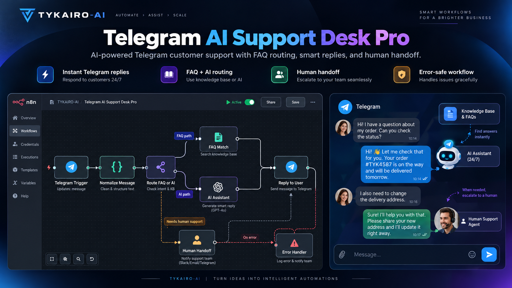
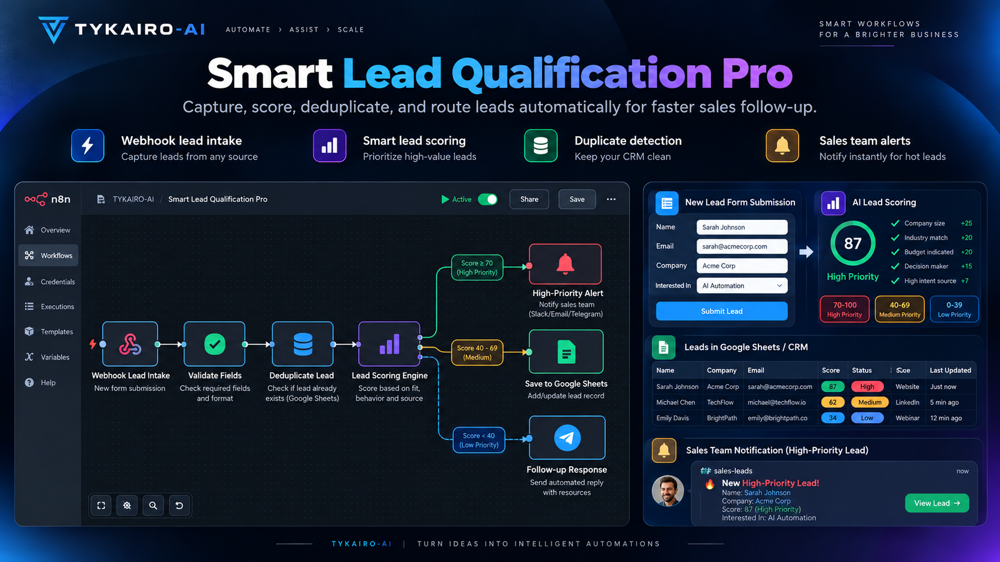
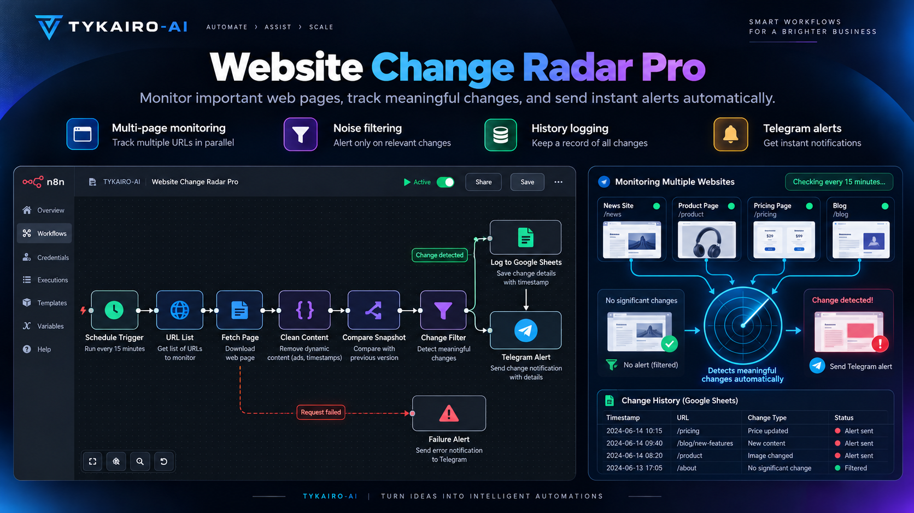

# TYKAIRO-AI — Free n8n Workflows

A collection of three free automation workflow concepts by **TYKAIRO-AI**.

> **Preview status:** These graphics are conceptual artwork, **not** screenshots of working n8n instances. Workflow JSON files and ZIP archives have **not yet been uploaded**. Do not treat the descriptions as verified production-ready features.

## Telegram AI Support Desk Pro

Telegram customer support concept with FAQ-based routing, AI-assisted response handling, and a human escalation path.

## Smart Lead Qualification Pro

Lead intake concept with field validation, configurable scoring, duplicate detection, and sales-team alerts.

## Website Change Radar Pro

Scheduled web-page monitoring concept with content comparison, change filtering, history logging, and Telegram alerts.

## Setup — once the JSON files are available

1. Download the workflow JSON and import it into n8n.
2. Connect credentials, replace example URLs/chat IDs, and adjust configuration.
3. Test every node and success/failure branch before activating it.
4. Never commit secrets or private customer data to version control.

Visit [TYKAIRO-AI](https://tykairo-ai.github.io/) to learn more about the company.

**Repository status:** Product previews and descriptions only. Workflow JSON, ZIP downloads, and real execution test reports still need to be published.
